<!--
  ┌──────────────────────────────────────────────────────────────┐
  │  RIDMA KITHARA — GitHub Profile                             │
  │  neon-noir edition · animated SVG + real project receipts   │
  │  Built with code, coffee and a little too much neon.        │
  └──────────────────────────────────────────────────────────────┘
-->

  <a href="https://github.com/Ridma-kithara">
    
  </a>

  

  
  
  
  

  
  
  
  

 

  

<table>
<tr>
<td width="33%" align="center" valign="top">
  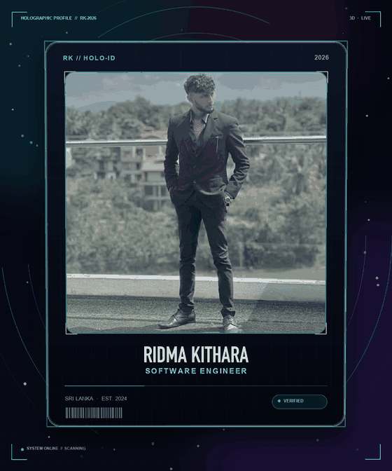
   
  <b>HOLO-ID // RK-2026</b> drag your cursor around the neon
</td>
<td width="67%" valign="top">

### Hey, I'm Ridma 👋

I'm a software engineering student from Sri Lanka who likes the part where an idea becomes a thing you can click, play, or break. My work sits where **code, play and real-world impact** overlap: Unity games, AI/IoT platforms and trilingual web experiences.

- 🎓 **HND in Software Engineering** — ICBT Campus / Cardiff Metropolitan University
- 🎮 **Founder** — RK VANTAGE GAMES, the studio behind **NEON VELOCITY**
- 🛡️ **Social Media & Webmaster Coordinator** — ICBT Campus
- 🧠 **Currently exploring** — Unity URP, FastAPI, Flutter, local AI and IoT
- 📍 **Based in** — Athurugiriya, Sri Lanka
- ⚡ **Builder's motto** — *Build it. Test it. Show the receipts.*

> **Now:** hardening NEON VELOCITY's premium backend · shipping TrustFarm's digital twin · keeping the Cyber Awareness Hub trilingual.

</td>
</tr>
</table>

 

  

  

| **Languages** | **Frameworks & data** | **Game / IoT / tools** |
| :--- | :--- | :--- |
| C# · Python · Java · Dart · JavaScript · TypeScript · PHP · SQL · HTML/CSS | Unity 6 · URP · Flutter · React · FastAPI · PostgreSQL · MySQL · scikit-learn | ESP32 · MQTT · Canvas 2D · Git · GitHub Actions · Docker · Linux · Figma |

  <b>Also in the toolbox:</b> Unity Input System · server-authoritative Python · Stripe / Apple IAP / Google Play verification · PlatformIO · Blender · Xcode · Android Studio

 

  

  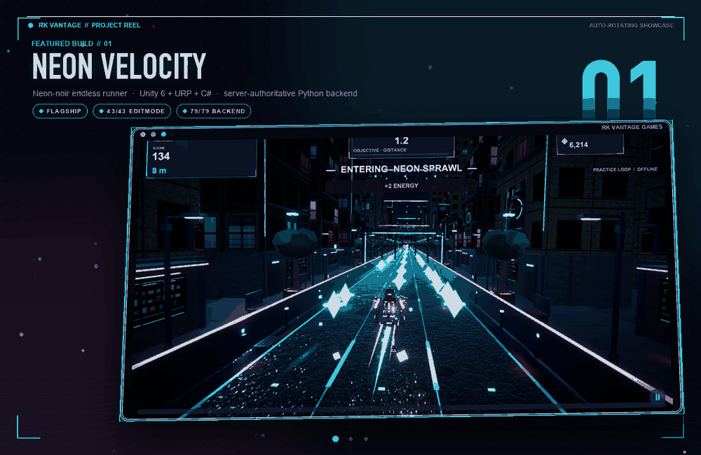

<h3 align="center">🎮 Featured builds</h3>

<table>
<tr>
<td width="56%" valign="top">

#### 🎮 NEON VELOCITY

A three-lane, **neon-noir endless runner** built in Unity 6 + URP + C#, with an original **server-authoritative Python multiplayer backend**.

- **20** rotating districts, a **7-state** time-of-day system and **6** game modes.
- Server-owned multiplayer circuit, premium GEM wallet, account recovery and platform IAP verification.
- **Verified build:** 43/43 EditMode · 18/18 PlayMode · 66/66 core · 79/79 backend · 936/936 static checks.

</td>
<td width="44%" valign="top">
  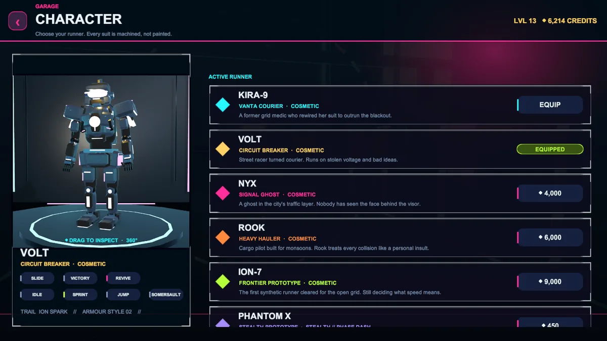
</td>
</tr>
</table>

<table>
<tr>
<td width="44%" valign="top">
  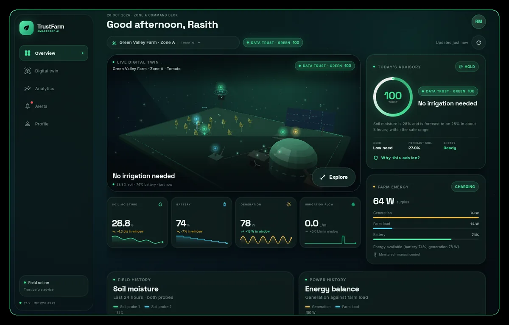
</td>
<td width="56%" valign="top">

#### 🌱 TrustFarm — SmartCrop AI

An end-to-end **smart agriculture platform** that turns raw sensor data into a trust score, a forecast and an irrigation decision a farmer can understand.

`ESP32 → MQTT → FastAPI → scikit-learn → React + Flutter`

- Live digital twin, soil/battery/generation telemetry and human-readable advice.
- Role-based web dashboards for farmers, officers and admins.
- A 3D hardware circuit explorer and a live interactive preview.

</td>
</tr>
</table>

<table>
<tr>
<td width="56%" valign="top">

#### 🛡️ Cyber Awareness Hub — Exito

A free, **trilingual cyber-security education platform** for ICBT Campus students — making phishing, scams, passwords and privacy make sense in **English, Sinhala and Tamil**.

- **8** core threat topics, a **30-question** FAQ bank and a **10-question** quiz with explanations.
- Hand-built **3D network globe** with drag inertia, depth fade and a reduced-motion fallback.
- Strict CSP, zero third-party runtime requests, XSS-safe rendering and self-hosted assets.

</td>
<td width="44%" valign="top">
  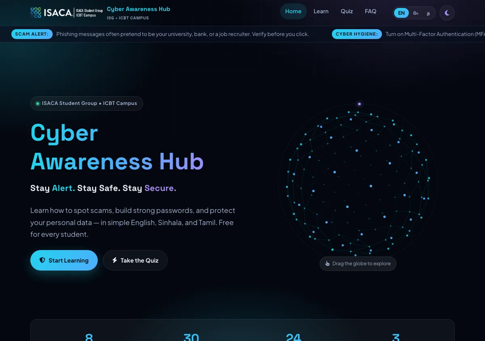
</td>
</tr>
</table>

 

<h3 align="center">🧪 More from the lab</h3>

<table>
<tr>
<td width="50%" valign="top">

**💊 MediQuick Pharmacy**  
PHP + MySQL pharmacy storefront with a product catalogue, prescription uploads, cart, checkout, order history and an admin dashboard.  
`PHP` · `MySQL` · `Bootstrap` · [repo →](https://github.com/Ridma-kithara/MediQuick-Pharmacy)

</td>
<td width="50%" valign="top">

**♻️ Automated E-Waste Management System**  
Python console app for e-waste inventory, search/sort, recycling fees and JSON persistence — a Fundamentals of Programming build.  
`Python` · `JSON` · `CLI` · [repo →](https://github.com/Ridma-kithara/Automated-E-Waste-Management-System-AEWMS-)

</td>
</tr>
<tr>
<td width="50%" valign="top">

**🏨 Hotel Management + Login**  
Two Spring Boot learning projects: room/booking management and employee/role-based authentication.  
`Java` · `Spring Boot` · `REST` · [hotel →](https://github.com/Ridma-kithara/hotel-management) · [login →](https://github.com/Ridma-kithara/login)

</td>
<td width="50%" valign="top">

**📡 IEEE ICBT Contact Info**  
HTML landing page for IEEE Day at ICBT Campus — contact details and event information.  
`HTML` · `CSS` · [repo →](https://github.com/Ridma-kithara/IEEE-ICBT-ContactInfo)

</td>
</tr>
</table>

<b>🖼️ Click for the screenshot gallery</b>

 
<table>
<tr>
<td width="50%">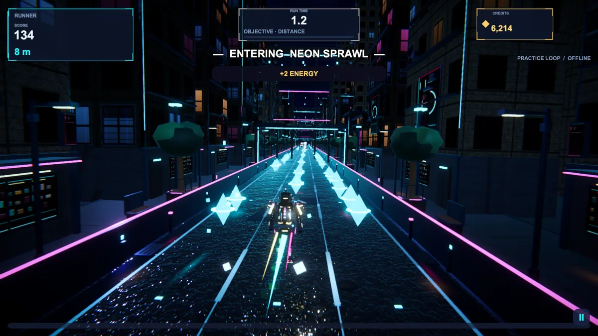</td>
<td width="50%">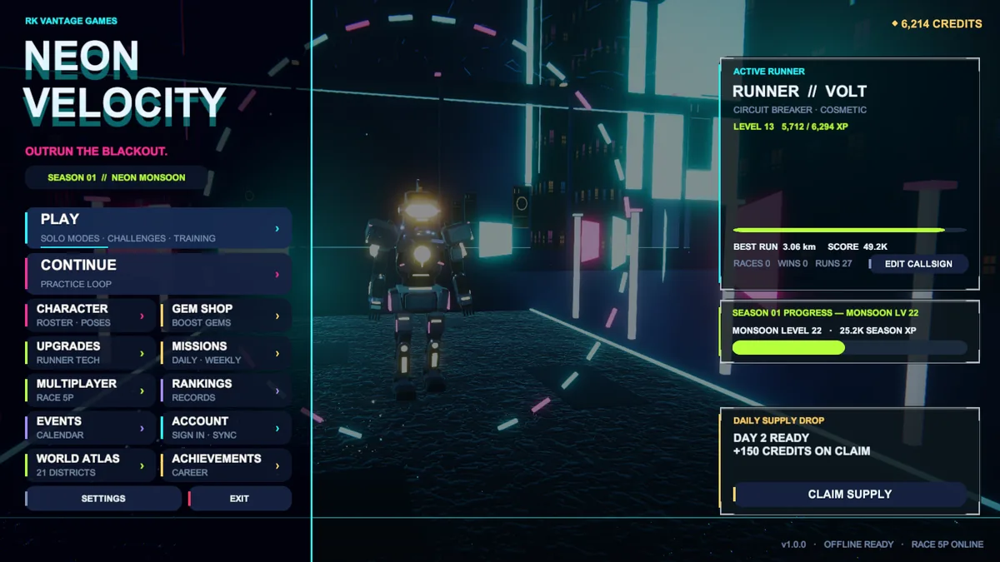</td>
</tr>
<tr>
<td width="50%">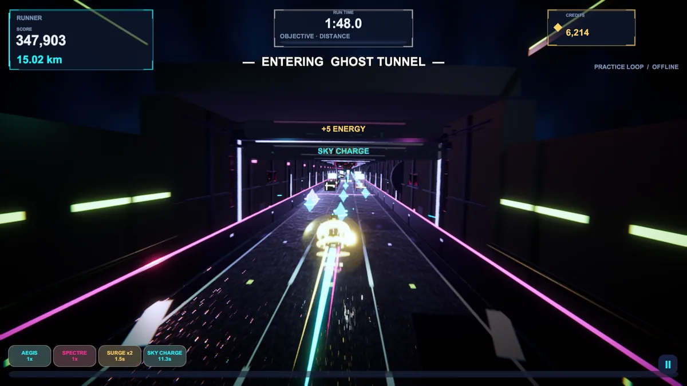</td>
<td width="50%">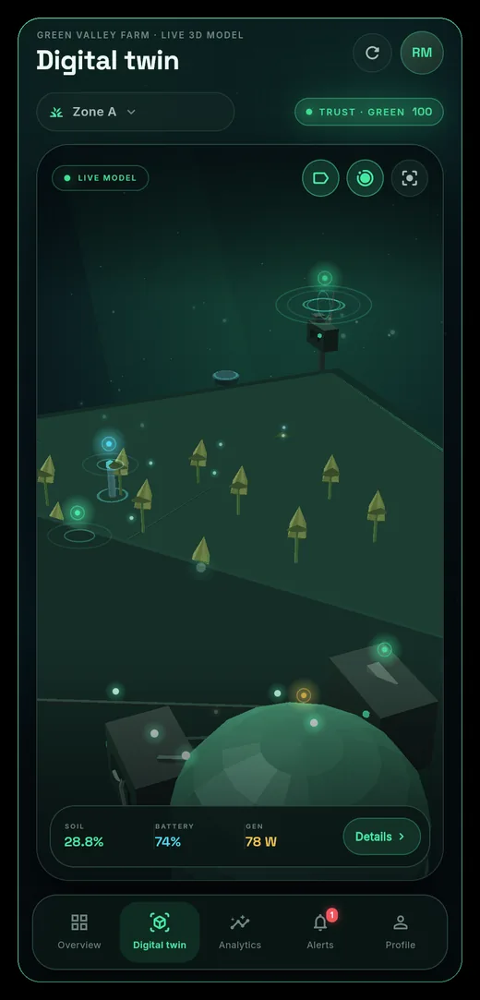</td>
</tr>
<tr>
<td width="50%">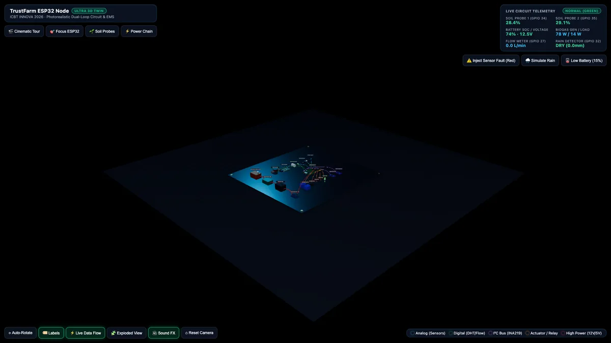</td>
<td width="50%">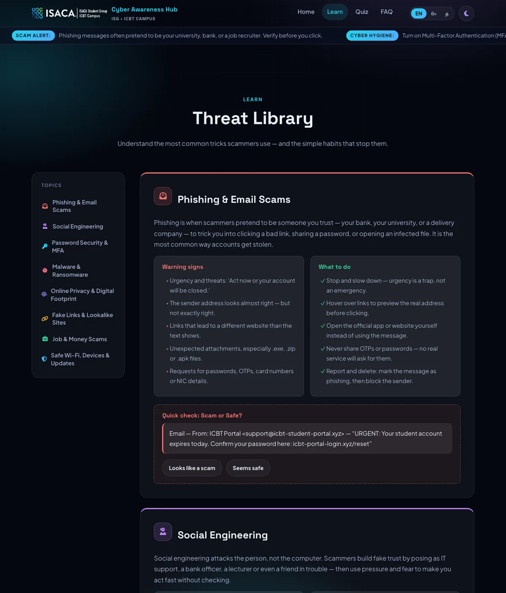</td>
</tr>
</table>

 

  

  

<table>
<tr>
<td width="50%" valign="top">

### 📜 Certificates & community

- 🎓 **GitHub Fundamentals Workshop** — StackNet × ICBT Campus
- 🔧 **Git & GitHub Workshop** — ISACA Student Group
- 🛡️ **Social Media & Webmaster Coordinator** — ICBT Campus
- 🚀 **Founder** — RK VANTAGE GAMES
- 🏆 **ICBT EXITO 2026** — Cyber Awareness Hub · **INNOVA 2026** — TrustFarm

</td>
<td width="50%" valign="top">

### 🔗 Receipts

- [NEON VELOCITY — Phase 03 report](https://github.com/Ridma-kithara/NEON-VELOCITY/blob/main/Documentation/PHASE03_FINAL_REPORT.md)
- [NEON VELOCITY — test report](https://github.com/Ridma-kithara/NEON-VELOCITY/blob/main/Documentation/TEST_REPORT.md)
- [NEON VELOCITY — known limitations](https://github.com/Ridma-kithara/NEON-VELOCITY/blob/main/Documentation/KNOWN_LIMITATIONS.md)
- [TrustFarm — live demo](https://ridma-kithara.github.io/TrustFarm_INNOVA/) · [3D circuit](https://ridma-kithara.github.io/TrustFarm_INNOVA/circuit.html)
- [Cyber Awareness Hub — live site](https://ridma-kithara.github.io/Cyber-Awareness-Hub-Exito-/)
- [LinkedIn — certificates & activity](https://www.linkedin.com/in/ridma-kithara-619243303)

</td>
</tr>
</table>

> **Verification note:** the telemetry above is pulled from the NEON VELOCITY Phase 03 report (30 Oct 2026). The repo also documents what is **not** verified yet — see `KNOWN_LIMITATIONS.md`. I would rather show the limits than overclaim.

 

  

  

  

  Self-hosted SVGs generated from the GitHub API — no third-party stats service, no 503s, no rate-limit badge graveyard.

<h3 align="center">🧊 3D contribution graph</h3>

  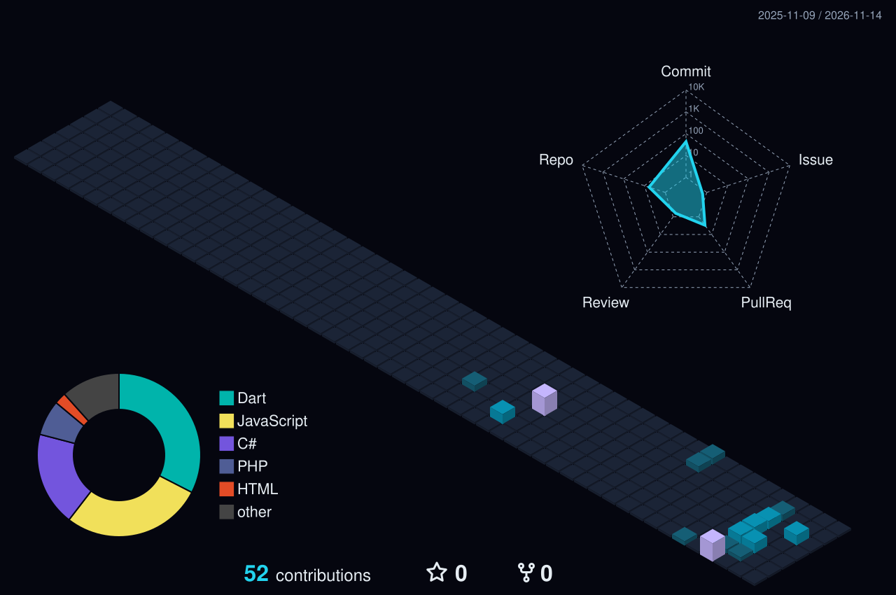

<h3 align="center">🐍 The snake that eats my contributions</h3>

  <picture>
    <source media="(prefers-color-scheme: dark)" srcset="https://raw.githubusercontent.com/Ridma-kithara/Ridma-kithara/main/assets/github-snake-dark.svg">
    <source media="(prefers-color-scheme: light)" srcset="https://raw.githubusercontent.com/Ridma-kithara/Ridma-kithara/main/assets/github-snake.svg">
    
  </picture>

 

  

<table>
<tr>
<td width="54%" valign="top">

### Let's build something.

I'm always up for a good build — especially if it mixes play, intelligence and real-world impact.

- 🎮 **Unity prototypes & game jams** — gameplay systems, URP looks, backend loops.
- 🌱 **AI + IoT for agriculture or sustainability** — sensors, dashboards, honest data.
- 🛡️ **Cyber-awareness & student-tech communities** — content, web, design.
- 🌐 **Trilingual web experiences** — English, Sinhala and Tamil from day one.

Best way to reach me: <b>LinkedIn DM</b>. I read everything, even the phishing emails.

</td>
<td width="46%" align="center" valign="top">

 

 

</td>
</tr>
</table>

 

  

  ⭐ If something here made you curious, star a repo or say hello. The neon is better with company.

